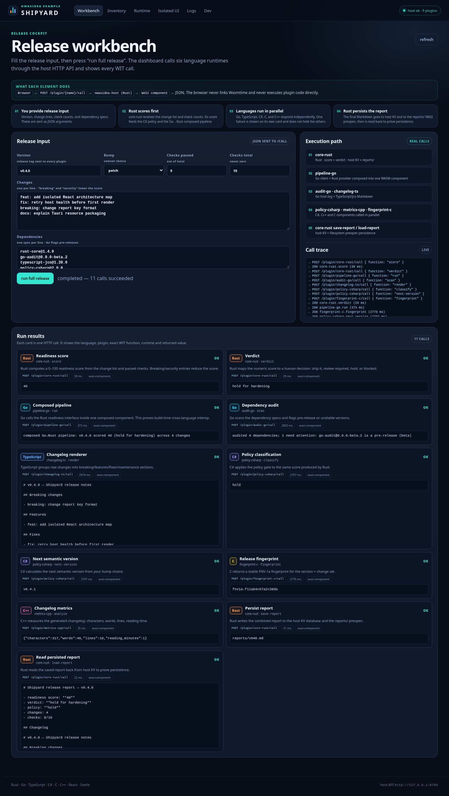

# 🚀 Owasidea — Build Desktop Apps with Any Language

> **One framework. Many languages. Zero friction.**

Owasidea lets teams build desktop applications where **Rust, Go, C, C++, C# and
TypeScript/JavaScript components coexist** in a single app — each written in the
language and framework its developers already know. No one blocks another. No one
rewrites. Everyone ships.

```
┌─────────────────────────────────────────────────────────────┐
│  Your App (Tauri)                                           │
│  ┌─────────────┐ ┌─────────────┐ ┌─────────────┐            │
│  │  Rust lib   │ │  Go service │ │  C# module  │  ...       │
│  │  (notes)    │ │  (chat-go)  │ │  (tester)   │            │
│  └──────┬──────┘ └──────┬──────┘ └──────┬──────┘            │
│         │               │               │                    │
│         └───────┬───────┴───────┬───────┘                    │
│                 │  WIT contracts │  Component Model          │
│                 └───────┬───────┘                            │
│                         │                                    │
│              Host (Rust + Wasmtime)                          │
│              HTTP API · Capability broker · Manifests       │
└─────────────────────────────────────────────────────────────┘
```

## ✨ Why Owasidea?

- **Polyglot by design** — Rust, Go, C, C++, C#, TypeScript all build to WASI
  components described by WIT.
- **Manifests auto-generated** from real WIT — never hand-written, never stale.
- **Capability enforcement** — plugins only get what they declare.
- **Compose at build time** — wire components together with `wasm-tools compose`.
- **One CLI** — `owasidea init/build/dev/run/inspect/validate/bundle`.
- **Interactive & headless** — beautiful prompts for humans, `--json` for agents.

## 🏁 Get Started in 60 Seconds

```bash
# 1. Install the CLI
cargo install --path crates/cli

# 2. Scaffold an app
owasidea init my-app && cd my-app

# 3. Add plugins in any language
owasidea plugin new notes --lang rust
owasidea plugin new chat  --lang go
owasidea plugin new ui    --lang yew --type ui

# 4. Build everything (compiles + generates manifests)
owasidea build

# 5. Develop (host + UI + recursive hot-reload watcher)
owasidea dev

# Or build and run without watching
owasidea build
owasidea run
```

## 🚢 Reference app: Shipyard

[`examples/shipyard`](examples/shipyard) is the end-to-end example: a release
cockpit that runs one release through six language runtimes, a composed
Go→Rust pipeline, host KV + filesystem persistence, a persistent service, an
executable `wasi:http` plugin, two isolated UI frameworks (Svelte + React), and
Tauri packages (`.deb` on Linux, NSIS `.exe` on Windows).



| Plugin | Language | Type | What it does |
|--------|----------|------|--------------|
| `core-rust` | Rust | library | readiness score, report persistence, KV + `reports/` preopen |
| `audit-go` | Go | library | dependency scan + host log |
| `changelog-ts` | TypeScript | library | markdown changelog via jco |
| `policy-csharp` | C# | library | policy gate + semantic version |
| `fingerprint-c` | C | library | FNV-1a release fingerprint via wasi-sdk |
| `metrics-cpp` | C++ | library | text metrics via wasi-sdk |
| `pipeline-go` | Go | library | composed Go→Rust readiness call |
| `watchtower-rust` | Rust | service | persistent lifecycle |
| `webhook-go` | Go | executable | `wasi:http/incoming-handler` |
| `board-svelte` | Svelte | UI | isolated release board |
| `map-react` | React | UI | isolated polyglot map |

```bash
cargo install --path crates/cli
cd examples/shipyard
owasidea build           # compile, compose, generate + sign manifests
owasidea test            # API smoke + Playwright UI tests
owasidea dev             # host + UI + watcher
owasidea bundle          # Tauri package with plugins bundled
```

See [Get Started](docs/GET_STARTED.md) for the full walkthrough and
[AI Agent Playbook](docs/AI_AGENTS.md) for deterministic automation steps.

## 🧩 More plugin examples

The repository root also keeps smaller focused examples:

| Plugin | Language | Type | What it does |
|--------|----------|------|--------------|
| `notes` | Rust | library | KV cache + greet/complete |
| `chat-go` | Go | executable | HTTP inbound/outbound |
| `example` | Rust | library | greet/compute/remember |
| `attr-go` | Go | library | source-generated WIT |
| `attr-ts` | TypeScript | library | source-generated WIT |
| `tester` (C#) | C# | library | componentize-dotnet |
| `heartbeat` | Rust | service | persistent lifecycle example |

WASI plugins expose WIT contracts. Libraries use `/plugin/{name}/call`, services
use `/plugin/{name}/service/*`, and executable HTTP components use `/app/{name}`.
Cross-language composition is validated (Go client → Rust notes).

## 🛠 Commands

```bash
owasidea doctor          # check toolchain
owasidea init <dir>      # scaffold app (interactive)
owasidea plugin new ...  # scaffold plugin (interactive)
owasidea build           # build + compose + sign + generate manifests
owasidea test            # build + API smoke + UI tests
owasidea smoke           # build + API smoke only
owasidea validate        # verify checksums & capabilities
owasidea run             # run host (default 127.0.0.1:8787)
owasidea dev             # build + host + UI dev server
owasidea inspect <name>  # show manifest
owasidea bundle          # build + sign + Tauri package
```

## 📚 Documentation

- [`docs/GET_STARTED.md`](docs/GET_STARTED.md) — full human walkthrough, zero to Tauri
- [`docs/GET_STARTED.pt-BR.md`](docs/GET_STARTED.pt-BR.md) — guia em português
- [`docs/AI_AGENTS.md`](docs/AI_AGENTS.md) — deterministic agent playbook
- [`docs/WINDOWS.md`](docs/WINDOWS.md) — native Windows support and cross-compilation boundaries
- [`docs/APPIMAGE.md`](docs/APPIMAGE.md) — AppImage packaging and clean-build requirements
- [`docs/UPDATER.md`](docs/UPDATER.md) — Tauri updater, latest.json, channels, local testing
- [`docs/CODE_SIGNING.md`](docs/CODE_SIGNING.md) — Windows Authenticode and macOS Developer ID/notarization, CI secrets and safe skip
- [`docs/RELEASE.md`](docs/RELEASE.md) — release checklist: gates, profiles, signing, CI secrets
- [`docs/CLEAN_BUILD.md`](docs/CLEAN_BUILD.md) — bubblewrap isolation and clean Arch/Debian chroot builds
- [`llms.txt`](llms.txt) — compact AI index
- `docs/USAGE.md` — setup and running
- `docs/CLI.md` — CLI reference
- `docs/API.md` — HTTP API
- `docs/ARCHITECTURE.md` — architecture
- `docs/PLUGIN_AUTHORING.md` — writing plugins
- `docs/SOURCE_GENERATORS.md` — source generators
- `docs/SECURITY.md` — security model
- `docs/UI_PLUGINS.md` — Yew/Blazor/Uno webview UI bundles
- `docs/REGISTRY.md` — signed HTTPS registry format and install flow
- `docs/ROADMAP.md` — roadmap

## 📄 License

MIT
