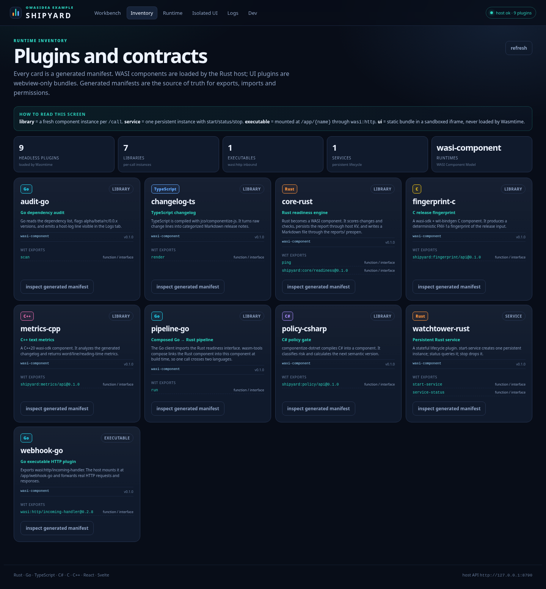
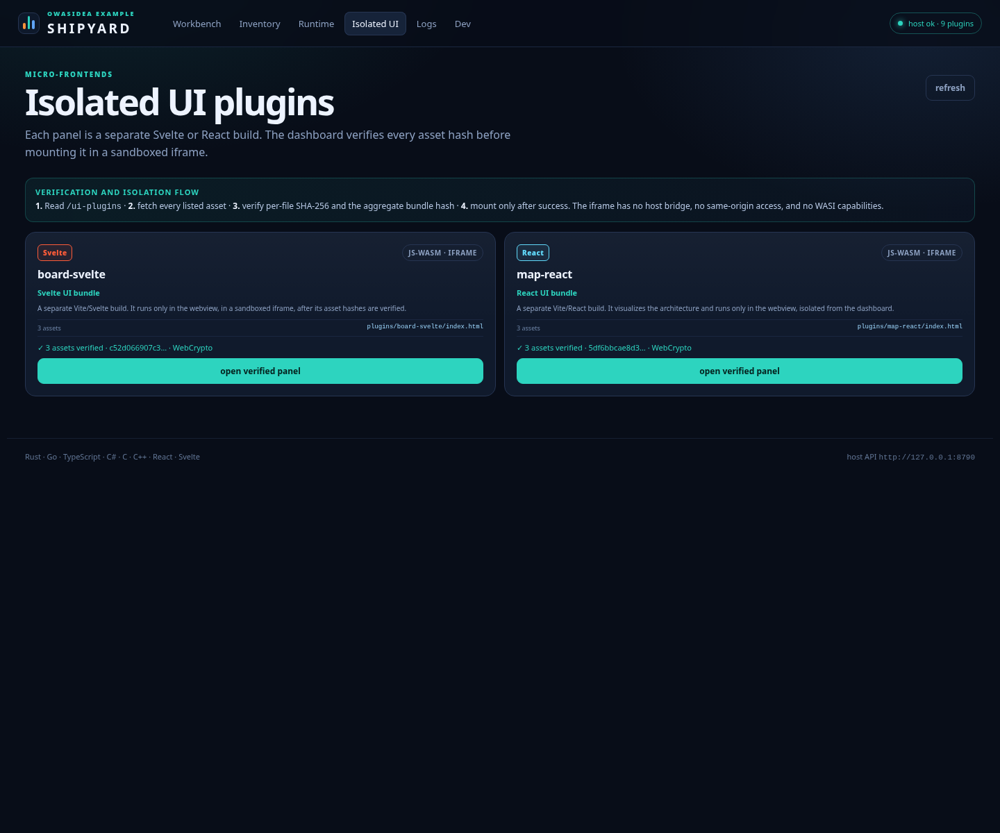

# Shipyard — polyglot release cockpit

A complete Owasidea reference app. Shipyard takes a release version, a list of
changes, dependency specs, and test results, then runs the release through six
language runtimes, a composed cross-language pipeline, a persistent service, an
executable HTTP plugin, and two isolated UI frameworks.


## What it proves

| Feature | Where |
|---|---|
| Rust library with WIT interface + host KV + filesystem preopen | `plugins/core-rust` |
| Go library with host-log import | `plugins/audit-go` |
| TypeScript component built with jco | `plugins/changelog-ts` |
| C# component built with componentize-dotnet | `plugins/policy-csharp` |
| C component built with wasi-sdk + wit-bindgen | `plugins/fingerprint-c` |
| C++20 component built with wasi-sdk + wit-bindgen | `plugins/metrics-cpp` |
| Build-time Go → Rust composition (`wasm-tools compose`) | `plugins/pipeline-go` + `compose_with` |
| Persistent stateful service lifecycle | `plugins/watchtower-rust` |
| Executable `wasi:http/incoming-handler` plugin | `plugins/webhook-go` |
| Isolated Svelte UI bundle | `plugins/board-svelte` |
| Isolated React UI bundle | `plugins/map-react` |
| Glue plugin (`app-glue`) routing workbench calls and service lifecycle | `plugins/app-glue` |
| Product dashboard calling the glue plugin only | `ui/` |
| Tauri 2 desktop packaging (deb/NSIS) with bundled plugins | `desktop/` |
| End-to-end smoke and browser tests | `owasidea smoke`, `owasidea test`, `tests/ui.spec.ts` |

## Architecture

```
Shipyard UI (vanilla TS + Vite, hashed UI-plugin iframes)
        │  HTTP + SSE
        ▼
owasidea-host (Rust + Wasmtime 50)
        │
        ├── app-glue          typed workbench dispatch + service-control
        ├── core-rust        score · verdict · save-report · load-report
        ├── audit-go         scan deps · host-log
        ├── changelog-ts     render markdown
        ├── policy-csharp    classify · next-version · summarize
        ├── fingerprint-c    fnv1a fingerprint · verify
        ├── metrics-cpp      words/lines/reading time
        ├── pipeline-go      imports shipyard:core/readiness (composed)
        ├── watchtower-rust  start-service / service-status
        └── webhook-go       wasi:http inbound at /app/webhook-go
```

`pipeline-go` is the important composition proof: its WIT imports
`shipyard:core/readiness@0.1.0`. `owasidea build` builds `core-rust` first, builds
the Go client, then runs `wasm-tools compose`. The generated manifest for
`pipeline-go` has no unresolved plugin imports; the host sees one self-contained
component.

## Run it

```bash
# one-time: install the framework CLI and Playwright runner
cargo install --path crates/cli
npm install
npx playwright install

cd examples/shipyard
owasidea doctor --install-wasi-sdk   # optional, only needed for C/C++
owasidea build                       # compile, compose, generate manifests
owasidea test                        # build + API smoke + Playwright
owasidea dev                         # build + host + Vite + watcher
owasidea run                         # run the last build without watching
```

`owasidea build` installs missing npm dependencies for the dashboard,
TypeScript plugins and UI plugins, derives manifests from real WIT, and copies
UI assets. `owasidea dev` rebuilds first, then starts the host and Vite.
All orchestration lives in the framework; the example has no shell scripts.

The app host listens on `127.0.0.1:8790`; `dev` uses
`127.0.0.1:5180` from `[dev].ui_addr` and prints both URLs. It is a foreground
process: open the UI URL in a browser and press `Ctrl+C` when finished. The
dashboard has six routes:

- **Workbench** — calls the `app-glue` plugin, which dispatches every language, and renders the release report.
- **Inventory** — lists plugins, exports, and generated manifests.
- **Runtime** — service start/status/stop, webhook health/event, metrics, dev
  status.
- **Isolated UI** — verifies every asset hash, then mounts the Svelte and React
  bundles in sandboxed iframes.
- **Logs** — historical logs plus SSE stream per plugin.
- **Dev** — watch roots and explicit component reload.



## Build and run the desktop app

```bash
owasidea bundle              # all targets configured by tauri.conf.json
owasidea bundle --bundles deb
owasidea bundle --bundles deb,rpm,appimage
```

`owasidea bundle` builds first, then runs the UI build and Tauri. The
artifact is copied to `dist/` because `[desktop].output = "dist"`. Shipyard
uses `"targets": "all"`; AppImage additionally requires a working
`linuxdeploy`/FUSE environment. If AppImage fails after `.deb`/`.rpm` were made,
the successful artifacts are still copied and the command reports the partial
failure. AppImage runs `linuxdeploy`; the CLI enables extract-and-run and
`NO_STRIP` automatically. On VMware hosts that ship a conflicting gdk-pixbuf,
hide the vendor directory from the bundler:

```bash
owasidea bundle --bundles appimage --isolate-host-libs
```

The flag runs Tauri inside `bwrap` with `/usr/lib/vmware` masked; it needs no
root and does not change the host. See `docs/APPIMAGE.md`.

The bundle step:

1. `owasidea build` produced `manifests` and component `.wasm` files.
2. `npm run build` in `ui/` produces `ui/dist`, including
   `plugins/board-svelte/` and `plugins/map-react/`.
3. `cargo tauri build` in `desktop/` embeds the frontend and packages the
   manifests, WASI component files and runtime descriptor as Tauri resources.
   `owasidea bundle` generates that list from `wasm-app.toml`; it is not
   hand-maintained.
4. At runtime the shell resolves `$RESOURCE/manifests` and sets
   `OWASIDEA_DATA_DIR` to the platform app-data directory.

The example uses `"targets": "all"` on Linux (`deb`, `rpm`, `AppImage`) and
Windows via `desktop/tauri.windows.conf.json` (NSIS/MSI). Use
`owasidea bundle --bundles deb` to restrict the output. Only configured plugins
are staged, so `node_modules`, build caches, and source files never enter the
installer; adding a `[plugins.*]` entry is enough.

## Test

```bash
# API smoke only: 10 WASI plugins, 2 UI plugins, glue, composition, KV/fs, service, HTTP
owasidea smoke

# Build + API smoke + Playwright UI tests
owasidea test

# Manifest/checksum/capability validation
owasidea validate
```

The Playwright suite covers:

1. The workbench calls all six languages and persists a report.
2. Both isolated UI bundles pass hash verification and mount in iframes.
3. Service lifecycle and executable webhook controls work.
4. Isolated UI still verifies and mounts when `crypto.subtle` is unavailable
   (plain-JS SHA-256 fallback, useful for restricted webviews).
5. Inventory opens a generated manifest and Logs loads the host-log ring buffer.



## File map

```
wasm-app.toml              app config: plugins, permissions, desktop shell
plugins/core-rust          Rust readiness core, KV + reports/ preopen
plugins/audit-go           Go dependency audit
plugins/changelog-ts       TypeScript changelog renderer
plugins/policy-csharp      C# policy/versioning
plugins/fingerprint-c      C FNV-1a fingerprint
plugins/metrics-cpp        C++ text metrics
plugins/pipeline-go        composed Go → Rust client
plugins/webhook-go         executable wasi:http plugin
plugins/watchtower-rust    persistent service
plugins/board-svelte       isolated Svelte UI bundle
plugins/map-react          isolated React UI bundle
ui/                        product dashboard (vanilla TS + Vite)
desktop/                   Tauri 2 shell and packaging config
dist/                      copied bundle artifact (gitignored)
tests/                     Playwright end-to-end spec
```

## Framework-driven configuration

`wasm-app.toml` also owns the developer workflow:

```toml
[test]
ui = ["npx", "playwright", "test", "--config", "playwright.config.ts"]

[[smoke.calls]]
plugin = "core-rust"
function = "score"
args = [["feat: add"], 9, 10]
min = 0
max = 100
```

`owasidea build` compiles and generates manifests,
`owasidea dev` rebuilds and watches, `owasidea smoke`
executes the declarative API checks, `owasidea test` adds the UI command, and
`owasidea bundle` packages Tauri and copies artifacts to `dist/`. No project
shell script is involved.

## Recreate the same shape for your app

```bash
owasidea init my-app
cd my-app
owasidea plugin new core --lang rust --type library
owasidea plugin new audit --lang go --type library
owasidea plugin new changelog --lang typescript --type library
owasidea plugin new policy --lang csharp --type library
owasidea plugin new fingerprint --lang c --type library
owasidea plugin new metrics --lang cpp --type library
owasidea plugin new watchtower --lang rust --type service
owasidea plugin new webhook --lang go --type executable
owasidea plugin new board --lang svelte --type ui
```

Then copy the working build files from this example (the language templates are
minimal), set permissions in `wasm-app.toml`, and add a `desktop/` shell if you
want a Tauri bundle. The full walkthrough is in
[`docs/GET_STARTED.md`](../../docs/GET_STARTED.md); the agent playbook is
[`docs/AI_AGENTS.md`](../../docs/AI_AGENTS.md).

## Windows

Native Windows builds use the same commands. `desktop/tauri.windows.conf.json`
selects NSIS and the `.ico` icon; C/C++ needs wasi-sdk for Windows plus MSYS2
`make` (or a per-plugin `build` override). Cross-compiling the Windows installer
from Linux is not supported by `owasidea bundle`; use a Windows host/CI runner.
See [`docs/WINDOWS.md`](../../docs/WINDOWS.md).

## Notes and limits

- Ports are intentionally different from the repository root app: host `8790`,
  Vite `5180`. This lets both run at the same time.
- UI plugins are presentational by default. They share no JavaScript state with
  the dashboard and receive no host bridge unless the plugin declares a `bridge`
  allowlist (`board-svelte` opts into `app-glue.call`).
- A running host keeps the component bytes loaded at startup. After a rebuild,
  restart the host (or use dev hot reload) before re-running tests; otherwise
  `/call` returns `checksum mismatch`.
- `pipeline-go` imports the Rust interface at build time, not at runtime. To add
  runtime plugin-to-plugin calls, the host would need an explicit broker; this
  example uses build-time composition and dashboard orchestration.
- Manifests are unsigned and checked by SHA-256. See `docs/SECURITY.md`.
